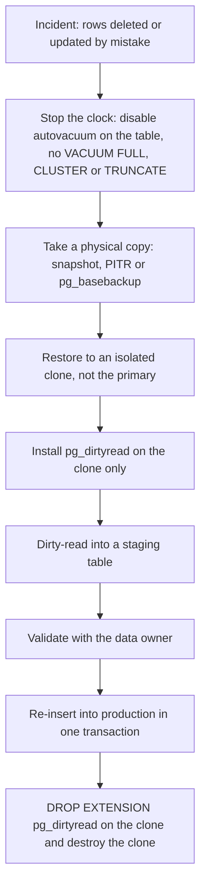
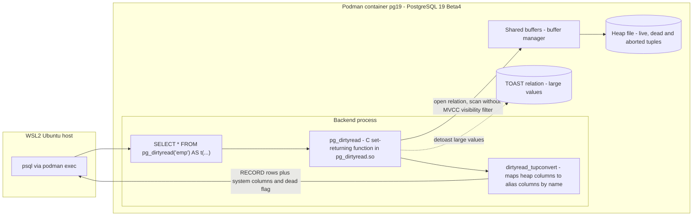
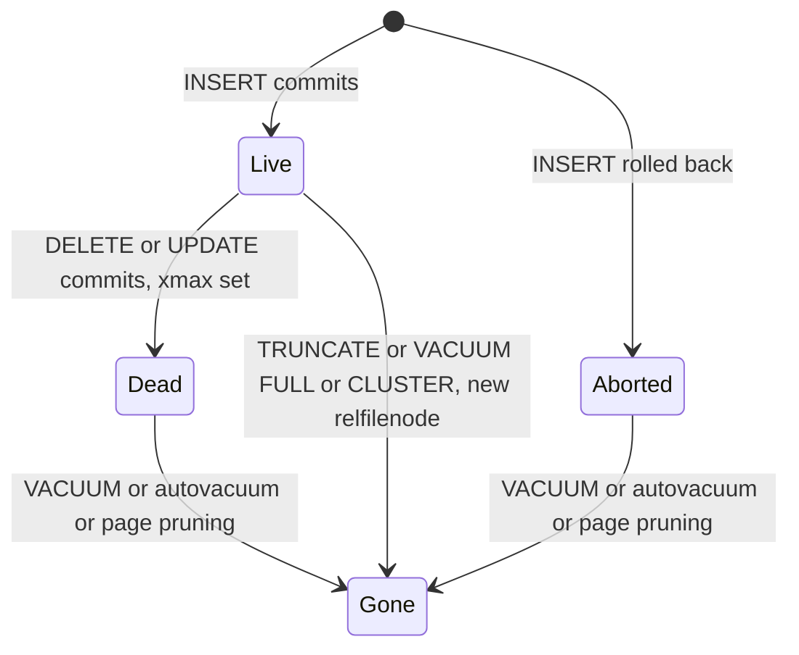
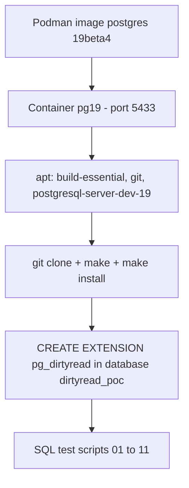

# pg_dirtyread PoC on PostgreSQL 19 (WSL2 + Podman)

Read **dead, deleted, updated, aborted and unvacuumed** tuples straight from a table's heap using the `pg_dirtyread` extension.

- Extension: [df7cb/pg_dirtyread](https://github.com/df7cb/pg_dirtyread)
- Target: PostgreSQL 19 (beta/rc), official image, rootful Podman on WSL2 Ubuntu
- Tested on: `psql 19rc1 (Debian 19~rc1-1.pgdg13+1)`, container `pg19`
- Use cases: accidental `DELETE`/`UPDATE` recovery, forensics, RCA ("what did this row look like before?")
- Framing: every result below is marked **Predicted** until you run it and tick **Confirmed**

---

## Awareness: should you use this in production?

**One line:** pg_dirtyread is a **break-glass recovery tool**, not a standing production component.

### What it is and is not

- Is: a way to read dead, updated and aborted row versions that are still physically on the page
- Is: useful after an accidental `DELETE` or `UPDATE`, or for forensics and RCA
- Is not: a backup, an audit log, or an undo button
- Is not: guaranteed. Vacuum, autovacuum, page pruning and table rewrites can erase the rows at any time

### Break-glass flow



### Confirmed in this PoC

| Finding | Result |
|---|---|
| Who can call it | **Superuser only**, even with `SELECT` on the table (`must be superuser to use pg_dirtyread`) |
| Child partition | Works, returns deleted rows too |
| Partitioned parent or non-heap table | Errors: `only heap AM is supported` |
| Large value stored inline, live row | Works |
| **Deleted row whose large value is stored out-of-line (TOAST)** | **Failed** with TOAST chunk errors on this build; cause not yet proven |
| Builds and loads on PG19 | Yes, on the `19rc1` image used here |

- Tests not yet ticked in the matrix below are still **Predicted**, not confirmed

### Risks to know

- Bypasses row visibility: output can contain data deleted on purpose (erasure requests, retention expiry). Treat it as sensitive
- You declare the column types: wrong types give garbage, and may do worse
- Needs a compiler and server headers to build (PG19 has no package yet), which you do not want on a production primary
- Must be rebuilt or reinstalled for each PostgreSQL major version
- Not supported by the managed-cloud extension lists checked (below)

### Best practice (self-managed)

- Work on a **clone**, not the primary
- Preserve evidence first: snapshot, then disable autovacuum on the table and its TOAST table
- Consider a **delayed standby** (`recovery_min_apply_delay`) as a standing safety net
- Recover via a **staging table**, validate, then re-insert in one transaction
- Run as a named DBA, in a logged session, and `DROP EXTENSION` afterwards
- Pin a release tag (or the PGDG package for PG10 to 18) and test on the same major version
- Never rely on it as the recovery plan: backups and PITR are the plan

### Managed cloud availability (checked 2026-10-17)

| Service | pg_dirtyread | Note |
|---|---|---|
| AWS RDS for PostgreSQL | Not listed | Not in AWS's extension tables for PG 19 (Beta 1 to 4), 18, 17, 16, 15 |
| AWS Aurora PostgreSQL | **Not verified** | List did not load; check `SELECT * FROM pg_available_extensions WHERE name = 'pg_dirtyread';` |
| GCP Cloud SQL for PostgreSQL | Not listed | Only supported extensions allowed, no custom ones |
| Azure Database for PostgreSQL Flexible Server | Not listed | Not in the by-name list (PG 11 to 18); no custom extensions |

- Provider lists change: re-check before relying on this table

### Alternatives on managed services

- **PITR or snapshot restore** to a new instance just before the mistake, then copy rows back (supported everywhere)
- **pageinspect** (listed on RDS, Cloud SQL and Azure) to read raw heap pages, but you must decode tuple bytes yourself
- **Self-managed clone** (restore or export to your own PostgreSQL) if you really need pg_dirtyread

---

## 1. Table of contents

- [Awareness: should you use this in production?](#awareness-should-you-use-this-in-production)
- [2. Version support](#2-version-support)
- [3. Architecture](#3-architecture)
- [4. Prerequisites](#4-prerequisites)
- [5. Step-by-step installation](#5-step-by-step-installation)
- [6. Sample data and feature tests](#6-sample-data-and-feature-tests)
- [7. Feature coverage matrix](#7-feature-coverage-matrix)
- [8. Limitations and gotchas](#8-limitations-and-gotchas)
- [9. Cheat sheet](#9-cheat-sheet)
- [10. Troubleshooting](#10-troubleshooting)
- [11. Cleanup](#11-cleanup)

---

## 2. Version support

| Item | Version | Note |
|---|---|---|
| PostgreSQL minimum | **9.2** (at least 9.2.9) | Per upstream README: "9.2 and later" |
| Extension 1.0 | 2012 | Written by Phil Sorber, basic dead-row read |
| Extension 1.1 | 2017 | Christoph Berg added system columns (`xmin`, `xmax`, `ctid`, ...) and took over maintenance |
| Extension 2.x | current line | Upgrade script `pg_dirtyread--1.0--2.sql` ships in the repo |
| Packaged builds seen | 2.8 (PGDG/Debian) | Packages cover PostgreSQL 10 to 18 |
| PostgreSQL 19 | **No package yet** | Build from source. Predicted to compile, **not yet confirmed** |
| `oid` column | PostgreSQL 11 and earlier only | Removed from user tables in PG12 |
| `dead` column | Not usable during recovery | i.e. not on standby servers |

- Upstream does not list a maximum PostgreSQL version; "9.2 and later" is open-ended
- This PoC is what confirms (or breaks) PG19 Beta4 compatibility

---

## 3. Architecture

### 3.1 Component view



- Normal `SELECT` applies an MVCC snapshot, so dead tuples are hidden
- `pg_dirtyread()` skips that filter and returns **every tuple version still physically on the page**
- Returns `RECORD`, so the caller must give a column alias list `AS t(col type, ...)`
- Columns are matched **by name**: you can omit or reorder columns
- Pure SQL + C extension: **no `shared_preload_libraries`, no restart, no background worker**
- Design notes above come from the upstream README and file layout; confirm details in `pg_dirtyread.c` if you want source-level proof

### 3.2 Tuple lifecycle: when can pg_dirtyread see it?



- `Live`, `Dead`, `Aborted` are all readable by `pg_dirtyread()`
- `Gone` means the bytes are no longer reliable: **recover before vacuum runs**
- Hence every test table below disables autovacuum

### 3.3 PoC topology



---

## 4. Prerequisites

- WSL2 Ubuntu with Podman working (rootful, same as your other PoCs)
- Internet access from the container (apt + GitHub)
- ~500 MB free disk for build tools

**Image tag check**

- Your original command used `postgres:19beta3`
- This PoC targets **Beta4**, so the tag below is `19beta4`
- You will verify the real version in Step 2 with `SELECT version();`

---

## 5. Step-by-step installation

### Step 1: Fresh container

```bash
# Variables - change only if needed
export PG_IMAGE=docker.io/library/postgres:19beta4
export PG_CT=pg19
export PG_PORT=5433
export POC_DIR="${POC_DIR:-$PWD/pg_dirtyread-poc}"
mkdir -p "$POC_DIR/sql"

# Remove any old container, then start fresh
podman rm -f "$PG_CT" 2>/dev/null
podman run -d --name "$PG_CT" \
  -e POSTGRES_PASSWORD=postgres \
  -p "$PG_PORT":5432 \
  "$PG_IMAGE"

# Wait until ready
until podman exec "$PG_CT" pg_isready -U postgres >/dev/null 2>&1; do sleep 1; done
echo "PostgreSQL is ready"
```

### Step 2: Confirm the server version

```bash
podman exec -it "$PG_CT" psql -U postgres -c "SELECT version();"
```

- Expect a `PostgreSQL 19` line and note the exact label (`beta3`, `beta4`, `rc1`)
- This PoC run reported `19rc1 (Debian 19~rc1-1.pgdg13+1)`
- If it is not the label you wanted, run `podman pull "$PG_IMAGE"` and redo Step 1

### Step 3: Install build tools inside the container

```bash
podman exec -u root "$PG_CT" bash -c '
  apt-get update &&
  apt-get install -y --no-install-recommends build-essential git ca-certificates postgresql-server-dev-19
'
```

- Needed because the official image ships no compiler and no server headers
- Package name must match the major version (`-19`)

### Step 4: Build and install the extension

```bash
podman exec -u root "$PG_CT" bash -c '
  set -e
  cd /tmp && rm -rf pg_dirtyread
  git clone https://github.com/df7cb/pg_dirtyread.git
  cd pg_dirtyread
  echo "Commit: $(git rev-parse --short HEAD)"
  make PG_CONFIG=/usr/lib/postgresql/19/bin/pg_config
  make install PG_CONFIG=/usr/lib/postgresql/19/bin/pg_config
'
```

- Optional: pin a release with `git checkout 2.8` before `make` (check `git tag` first)
- **This is the step that confirms or breaks PG19 compatibility**: note the commit hash and any compiler error

### Step 5: Verify installed files

```bash
podman exec "$PG_CT" bash -c '
  ls -l /usr/lib/postgresql/19/lib/pg_dirtyread.so
  ls -l /usr/share/postgresql/19/extension/pg_dirtyread*
'
```

- Expect `pg_dirtyread.so`, `pg_dirtyread.control`, `pg_dirtyread--1.0.sql`, `pg_dirtyread--1.0--2.sql`, `pg_dirtyread--2.sql`

### Step 6: Create the PoC database and the extension

```bash
podman exec -i "$PG_CT" psql -U postgres <<'EOF'
DROP DATABASE IF EXISTS dirtyread_poc;
CREATE DATABASE dirtyread_poc;
EOF

podman exec -i "$PG_CT" psql -U postgres -d dirtyread_poc <<'EOF'
CREATE EXTENSION pg_dirtyread;
\dx pg_dirtyread
\df pg_dirtyread
EOF
```

- No restart needed
- Create the extension as a **superuser** (as upstream recommends)

### Step 7: Helper for running test scripts

```bash
psql_poc() { podman exec -i "$PG_CT" psql -U postgres -d dirtyread_poc -X -a "$@"; }
```

- `-a` echoes every statement so output reads like a lab log
- Usage: `psql_poc < "$POC_DIR/sql/01_basic.sql"`

---

## 6. Sample data and feature tests

- Tests **01 to 04 share table `emp`: run them in order**
- Tests 05 to 11 are independent
- Every test table sets `autovacuum_enabled = false` so dead tuples stay put

### Test 01: Basic DELETE and UPDATE visibility

```bash
cat > "$POC_DIR/sql/01_basic.sql" <<'EOF'
DROP TABLE IF EXISTS emp;
CREATE TABLE emp (
  id     int PRIMARY KEY,
  name   text,
  dept   text,
  salary numeric(10,2),
  notes  text
);
ALTER TABLE emp SET (autovacuum_enabled = false, toast.autovacuum_enabled = false);

INSERT INTO emp
SELECT g, 'emp_' || g, (ARRAY['HR','IT','FIN','OPS'])[1 + g % 4], 30000 + g * 1000, 'note ' || g
FROM generate_series(1, 10) g;

DELETE FROM emp WHERE id IN (3, 7);
UPDATE emp SET salary = salary + 5000 WHERE id = 1;

-- Live rows vs everything on the page
SELECT 'live' AS what, count(*) FROM emp
UNION ALL
SELECT 'live + dead', count(*) FROM pg_dirtyread('emp') t(id int);

-- Full dirty read
SELECT * FROM pg_dirtyread('emp') t(id int, name text, dept text, salary numeric(10,2))
ORDER BY id, salary;
EOF
psql_poc < "$POC_DIR/sql/01_basic.sql"
```

- **Predicted**: live = 8, live + dead = 11
- **Predicted**: ids 3 and 7 appear in dirty read; id 1 appears twice (31000.00 old, 36000.00 new)

### Test 02: System columns and the `dead` flag

```bash
cat > "$POC_DIR/sql/02_system_columns.sql" <<'EOF'
-- Aborted insert: should be readable too
BEGIN;
INSERT INTO emp VALUES (99, 'ghost', 'IT', 1.00, 'rolled back');
ROLLBACK;

SELECT tableoid::regclass AS rel, ctid, xmin, xmax, cmin, cmax, dead, id, name, salary
FROM pg_dirtyread('emp')
     AS t(tableoid oid, ctid tid, xmin xid, xmax xid, cmin cid, cmax cid, dead boolean,
          id int, name text, salary numeric(10,2))
ORDER BY ctid;
EOF
psql_poc < "$POC_DIR/sql/02_system_columns.sql"
```

- **Predicted**: deleted rows (3, 7) and the old version of id 1 have `xmax` set and `dead = t`
- **Predicted**: ghost row id 99 shows `dead = t` (aborted insert)
- **Predicted**: live rows have `xmax = 0`, `dead = f`
- `ctid` of each row = `(page, line pointer)`: reused in Test 06

### Test 02b: Column reference (what every column says)

```bash
cat > "$POC_DIR/sql/02b_column_reference.sql" <<'EOF'
SELECT * FROM pg_dirtyread('emp')
      AS t(tableoid oid, ctid tid, xmin xid, xmax xid, cmin cid, cmax cid, dead boolean,
            name text, dept text, salary numeric(10,2));
EOF
psql_poc < "$POC_DIR/sql/02b_column_reference.sql"
```

- Run after Test 02 (needs the `emp` table and its dead rows)
- `id` is left out on purpose: columns are matched **by name**, so you can return any subset
- Seven are **system / pseudo columns** (first seven), three are **user columns** (last three)

#### What each column says

| Column | Type | What it says | How to read it |
|---|---|---|---|
| `tableoid` | `oid` | OID of the table the tuple belongs to (`pg_class.oid`) | Cast with `tableoid::regclass` to see the name. For partitions it is the **child** table |
| `ctid` | `tid` | Physical address of this tuple version: `(block number, line pointer)` | Every version has its own `ctid`. An `UPDATE` creates a new version at a new `ctid`. Matches `lp` in `heap_page_items()` (Test 06) |
| `xmin` | `xid` | Transaction ID that **created** this version (the `INSERT`, or the `UPDATE` that wrote it) | Smaller number = older transaction. Same `xmin` on several rows = same transaction |
| `xmax` | `xid` | Transaction ID that **deleted or updated** this version. `0` means nobody has | Non-zero is not proof of deletion: it can also be a row lock, or a deleter that rolled back |
| `cmin` | `cid` | Command number (statement order) inside `xmin`'s transaction that created the version | Only meaningful inside one multi-statement transaction. Mostly `0` for autocommit statements |
| `cmax` | `cid` | Command number inside `xmax`'s transaction that deleted or updated it | Same caveat as `cmin`. PostgreSQL may store both in one header field, so do not over-interpret them |
| `dead` | `boolean` | Added by pg_dirtyread, not a real column. `t` = the version is **surely dead** (deleted or updated and no longer visible to anyone, or an aborted insert). `f` = live, or possibly still visible to some snapshot | A hint, not a guarantee. Not usable on a standby |
| `name`, `dept` | `text` | User data, as stored in that version | Types must match the table definition |
| `salary` | `numeric(10,2)` | User data, as stored in that version | Declare the same type and modifier as the table |

#### How to read a row (predicted until you confirm)

| `xmax` | `dead` | Most likely meaning |
|---|---|---|
| `0` | `f` | Live row |
| non-zero | `t` | Deleted row, or the **old version** of an updated row |
| `0` | `t` | Aborted insert (the inserting transaction rolled back) |
| non-zero | `f` | Deleted or updated very recently and still visible to an older snapshot, **or** only a row lock, **or** the deleting transaction rolled back |

- Your `xmin`/`xmax` numbers will differ from anyone else's: compare them **within your own output**
- To see who or when, `pg_xact_commit_timestamp(xmin)` works only if `track_commit_timestamp = on` when the transaction committed
- Cross-check any row with `heap_page_items()` in Test 06: `ctid` = `(0, lp)`, `xmin`/`xmax` = `t_xmin`/`t_xmax`

### Test 03: Dropped columns (`dropped_N`)

```bash
cat > "$POC_DIR/sql/03_dropped_column.sql" <<'EOF'
-- notes is the 5th column of emp
ALTER TABLE emp DROP COLUMN notes;

-- The live table no longer has it
\d emp

-- But the data is still on the page
SELECT id, name, dropped_5
FROM pg_dirtyread('emp') t(id int, name text, dropped_5 text)
ORDER BY id;
EOF
psql_poc < "$POC_DIR/sql/03_dropped_column.sql"
```

- `dropped_N` = the Nth column counting from 1
- **Predicted**: all rows still show their `notes` text via `dropped_5`
- Postgres deletes the original type info, so you must supply the right type yourself
- Upstream only sanity-checks type length, alignment, modifier and pass-by-value

### Test 04: Column subset, reorder, and undelete

```bash
cat > "$POC_DIR/sql/04_mapping_recovery.sql" <<'EOF'
-- Subset + reorder (columns are matched by name)
SELECT * FROM pg_dirtyread('emp') t(salary numeric(10,2), name text)
ORDER BY name LIMIT 5;

-- Undelete ids 3 and 7.
-- Stage first: inserting while dirty-reading the same table can re-read the new rows.
DROP TABLE IF EXISTS emp_rescue;
CREATE TABLE emp_rescue AS
SELECT d.id, d.name, d.dept, d.salary
FROM pg_dirtyread('emp') d(id int, name text, dept text, salary numeric(10,2))
WHERE d.id IN (3, 7)
  AND NOT EXISTS (SELECT 1 FROM emp e WHERE e.id = d.id);

INSERT INTO emp (id, name, dept, salary)
SELECT id, name, dept, salary FROM emp_rescue;

SELECT id, name, dept, salary FROM emp WHERE id IN (3, 7) ORDER BY id;
EOF
psql_poc < "$POC_DIR/sql/04_mapping_recovery.sql"
```

- **Predicted**: rows 3 and 7 are back in the live table
- If a row had several dead versions, pick one (for example highest `xmax` via `DISTINCT ON`)

### Test 05: Large values and TOAST

```bash
cat > "$POC_DIR/sql/05_toast.sql" <<'EOF'
DROP TABLE IF EXISTS docs;
CREATE TABLE docs (id int, body text);
ALTER TABLE docs SET (autovacuum_enabled = false, toast.autovacuum_enabled = false);

INSERT INTO docs SELECT g, repeat('x', 100000) FROM generate_series(1, 3) g;
DELETE FROM docs WHERE id = 2;

SELECT id, length(body) AS body_len
FROM pg_dirtyread('docs') t(id int, body text)
ORDER BY id;
EOF
psql_poc < "$POC_DIR/sql/05_toast.sql"
```

- `repeat('x', 100000)` compresses to a few hundred bytes, so it is stored **inline**, not in TOAST chunks
- **Predicted**: 3 rows, each `body_len` = 100000, including deleted id 2
- **Confirmed earlier**: live rows with large incompressible values (160000 characters, out-of-line) read fine
- **Confirmed earlier (failure)**: a **deleted** row with an out-of-line value failed with `unexpected chunk number ... for toast value` (large) or `missing chunk number 0 ...` (small)
- Cause not proven: possible pruning of the dead TOAST chunks, not confirmed
- Lesson: do not count on recovering deleted rows with large out-of-line values

### Test 06: Cross-check with pageinspect

```bash
cat > "$POC_DIR/sql/06_pageinspect.sql" <<'EOF'
CREATE EXTENSION IF NOT EXISTS pageinspect;

SELECT lp, lp_flags, t_xmin, t_xmax, t_ctid
FROM heap_page_items(get_raw_page('emp', 0))
ORDER BY lp;
EOF
psql_poc < "$POC_DIR/sql/06_pageinspect.sql"
```

- Compare `lp` with the line-pointer part of `ctid` from Test 02
- `lp_flags`: 1 = normal tuple, 2 = redirect, 3 = dead, 0 = unused
- **Predicted**: same tuple count as `pg_dirtyread`, same `t_xmin`/`t_xmax` as `xmin`/`xmax`
- pageinspect ships in the official image (contrib)

### Test 07: Effect of VACUUM and VACUUM FULL

```bash
cat > "$POC_DIR/sql/07_vacuum.sql" <<'EOF'
SELECT count(*) AS before_vacuum FROM pg_dirtyread('emp') t(id int);
VACUUM emp;
SELECT count(*) AS after_vacuum  FROM pg_dirtyread('emp') t(id int);

-- Dropped column vs rewrite
DROP TABLE IF EXISTS ab;
CREATE TABLE ab (a text, b text);
ALTER TABLE ab SET (autovacuum_enabled = false, toast.autovacuum_enabled = false);
INSERT INTO ab VALUES ('Hello', 'World');
ALTER TABLE ab DROP COLUMN b;

SELECT * FROM pg_dirtyread('ab') t(a text, dropped_2 text);   -- before rewrite
VACUUM FULL ab;
SELECT * FROM pg_dirtyread('ab') t(a text, dropped_2 text);   -- after rewrite
EOF
psql_poc < "$POC_DIR/sql/07_vacuum.sql"
```

- **Predicted**: `after_vacuum` is lower than `before_vacuum` (dead and aborted tuples removed)
- **Predicted**: `dropped_2` shows `World` before `VACUUM FULL`, and **NULL** (data lost) after
- Lesson: stop autovacuum and avoid rewrites **before** you try to recover

### Test 08: TRUNCATE creates a new file

```bash
cat > "$POC_DIR/sql/08_truncate.sql" <<'EOF'
DROP TABLE IF EXISTS tr;
CREATE TABLE tr (id int);
ALTER TABLE tr SET (autovacuum_enabled = false);
INSERT INTO tr SELECT generate_series(1, 5);

SELECT pg_relation_filenode('tr') AS filenode_before;
DELETE FROM tr WHERE id <= 2;
SELECT count(*) AS dirty_before FROM pg_dirtyread('tr') t(id int);

TRUNCATE tr;
SELECT pg_relation_filenode('tr') AS filenode_after;
SELECT count(*) AS dirty_after FROM pg_dirtyread('tr') t(id int);
EOF
psql_poc < "$POC_DIR/sql/08_truncate.sql"
```

- **Predicted**: `dirty_before` = 5, `filenode` changes, `dirty_after` = 0

### Test 09: Partitioned tables

```bash
cat > "$POC_DIR/sql/09_partition.sql" <<'EOF'
DROP TABLE IF EXISTS sales CASCADE;
CREATE TABLE sales (id int, region text, amt int) PARTITION BY LIST (region);
CREATE TABLE sales_in PARTITION OF sales FOR VALUES IN ('IN');
CREATE TABLE sales_us PARTITION OF sales FOR VALUES IN ('US');
ALTER TABLE sales_in SET (autovacuum_enabled = false, toast.autovacuum_enabled = false);
ALTER TABLE sales_us SET (autovacuum_enabled = false, toast.autovacuum_enabled = false);

INSERT INTO sales SELECT g, CASE WHEN g % 2 = 0 THEN 'IN' ELSE 'US' END, g * 10
FROM generate_series(1, 10) g;
DELETE FROM sales WHERE region = 'IN' AND id <= 4;

-- Child partition
SELECT * FROM pg_dirtyread('sales_in') t(id int, region text, amt int) ORDER BY id;

-- Parent (has no storage of its own): this ERROR is EXPECTED
SELECT * FROM pg_dirtyread('sales') t(id int, region text, amt int);

-- Workaround: read every leaf partition and combine
SELECT 'sales_in' AS part, * FROM pg_dirtyread('sales_in') t(id int, region text, amt int)
UNION ALL
SELECT 'sales_us', * FROM pg_dirtyread('sales_us') t(id int, region text, amt int)
ORDER BY id;
EOF
psql_poc < "$POC_DIR/sql/09_partition.sql"
```

- The `ERROR:  only heap AM is supported` in the middle of the output is **expected**, not a failed install
- A partitioned parent has no heap of its own, so there is nothing to read
- Use the `UNION ALL` workaround (or one query per leaf partition) to see every partition

- **Confirmed**: child partition works and returns deleted ids 2 and 4 (plus live 6, 8, 10)
- **Confirmed**: parent call fails with `ERROR:  only heap AM is supported`
- **Confirmed**: the `UNION ALL` query returns all 10 original ids, 5 from `sales_in` and 5 from `sales_us` (ids 2 and 4 are the deleted rows)
- The `ERROR` line may print **after** the parent query's neighbours because psql sends errors to stderr and results to stdout; the order is cosmetic

### Test 10: Privileges

```bash
cat > "$POC_DIR/sql/10_privileges.sql" <<'EOF'
DO $$ BEGIN
  IF NOT EXISTS (SELECT FROM pg_roles WHERE rolname = 'poc_user') THEN
    CREATE ROLE poc_user LOGIN PASSWORD 'poc_user';
  END IF;
END $$;
GRANT SELECT ON emp TO poc_user;

SET ROLE poc_user;
SELECT count(*) FROM pg_dirtyread('emp') t(id int);
RESET ROLE;
EOF
psql_poc < "$POC_DIR/sql/10_privileges.sql"
```

- **Confirmed**: `poc_user` with `SELECT` on `emp` gets `ERROR:  must be superuser to use pg_dirtyread`
- The check is inside the extension, so a table grant does not help
- Security point: dirty read bypasses row visibility, and it is already restricted to superusers

### Test 11 (optional, ~2 minutes): Autovacuum ON contrast

```bash
cat > "$POC_DIR/sql/11_autovacuum.sql" <<'EOF'
DROP TABLE IF EXISTS av;
CREATE TABLE av (id int, v text);            -- autovacuum left at default (on)
INSERT INTO av SELECT g, 'x' FROM generate_series(1, 1000) g;
DELETE FROM av WHERE id <= 500;

SELECT count(*) AS right_after_delete FROM pg_dirtyread('av') t(id int);
SELECT pg_sleep(120);
SELECT count(*) AS after_autovacuum   FROM pg_dirtyread('av') t(id int);
EOF
psql_poc < "$POC_DIR/sql/11_autovacuum.sql"
```

- **Predicted**: 1000 right after delete, then 500 once autovacuum has run
- If still 1000, wait longer and check `SELECT last_autovacuum FROM pg_stat_user_tables WHERE relname='av';`

---

## 7. Feature coverage matrix

| # | Feature | Test | Predicted | Confirmed |
|---|---|---|---|---|
| 1 | Read deleted rows | 01 | Visible | [ ] |
| 2 | Read old versions of updated rows | 01 | Visible | [ ] |
| 3 | System columns `tableoid`, `ctid`, `xmin`, `xmax`, `cmin`, `cmax` | 02 | Returned | [ ] |
| 4 | `dead` boolean | 02 | `t` for deleted and aborted | [ ] |
| 5 | Aborted (rolled back) inserts | 02 | Visible, `dead = t` | [ ] |
| 6 | Dropped columns via `dropped_N` | 03 | Data recoverable | [ ] |
| 7 | Column subset and reorder by name | 04 | Works | [ ] |
| 8 | Undelete via `INSERT ... SELECT` (staged) | 04 | Rows restored | [ ] |
| 9 | TOAST values | 05 | Inline and live out-of-line values read; **deleted out-of-line values failed** | [x] partial |
| 10 | Match against `pageinspect` | 06 | Same tuples | [ ] |
| 11 | VACUUM removes dead rows | 07 | Count drops | [ ] |
| 12 | VACUUM FULL loses dropped-column data | 07 | NULL | [ ] |
| 13 | TRUNCATE loses everything | 08 | 0 rows | [ ] |
| 14 | Partition child readable, parent not | 09 | Child works, parent errors `only heap AM is supported` | [x] |
| 15 | Non-superuser access | 10 | Superuser only, even with table SELECT | [x] |
| 16 | Autovacuum erases evidence | 11 | Count drops | [ ] |
| 17 | **Builds and loads on PG19 Beta4** | Step 4, 6 | Should compile | [ ] |

---

## 8. Limitations and gotchas

- **Not a backup**: only tuples not yet cleaned up are readable
- Cleanup sources: `VACUUM`, autovacuum, **HOT/page pruning during normal reads and writes**
- Page pruning means even with autovacuum off, busy pages can lose dead tuples
- Rewrites destroy evidence: `VACUUM FULL`, `CLUSTER`, `TRUNCATE`, table-rewriting `ALTER TABLE`
- You must supply column types in the alias; wrong types can give garbage or errors
- Dropped column types are unknown to Postgres, so checks are limited
- `oid` column only on PostgreSQL 11 and earlier
- `dead` column unavailable on standbys
- Returns data bypassing visibility rules: restrict who may run it
- Never `INSERT ... SELECT` from `pg_dirtyread()` into the **same** table in one step: stage first (Test 04)
- Deleted rows with out-of-line (TOASTed) values failed with chunk errors in this PoC (Test 05)
- Run it on each leaf partition: partitioned parents and non-heap tables error with `only heap AM is supported`
- Superuser only: `must be superuser to use pg_dirtyread`
- Beta software: do this in a throwaway container only

**Emergency recovery order (real incident)**

- 1. Stop writes or disable autovacuum on the table immediately
- 2. Do not run `VACUUM FULL`, `CLUSTER`, `TRUNCATE`
- 3. Dirty-read into a staging table
- 4. Validate, then reinsert

---

## 9. Cheat sheet

```sql
-- Install
CREATE EXTENSION pg_dirtyread;

-- Protect evidence on a table
ALTER TABLE t SET (autovacuum_enabled = false, toast.autovacuum_enabled = false);

-- Basic
SELECT * FROM pg_dirtyread('t') AS x(col1 type1, col2 type2);

-- Subset / reorder
SELECT * FROM pg_dirtyread('t') AS x(col2 type2, col1 type1);

-- With system columns
SELECT * FROM pg_dirtyread('t')
  AS x(ctid tid, xmin xid, xmax xid, dead boolean, col1 type1);

-- Dropped column 3
SELECT * FROM pg_dirtyread('t') AS x(col1 type1, dropped_3 text);

-- Only dead rows
SELECT * FROM pg_dirtyread('t') AS x(dead boolean, col1 type1) WHERE dead;

-- Rescue into a staging table
CREATE TABLE t_rescue AS
SELECT * FROM pg_dirtyread('t') AS x(col1 type1, col2 type2) WHERE col1 = 42;
```

- Optional "who/when" angle: `pg_xact_commit_timestamp(xmin)` works only if `track_commit_timestamp = on` when the transaction committed

---

## 10. Troubleshooting

| Symptom | Likely cause | Fix |
|---|---|---|
| `Unable to locate package postgresql-server-dev-19` | Beta repo component not visible to apt | Run `apt-cache policy postgresql-server-dev-19`; check `/etc/apt/sources.list.d/` in the container; run `apt-get update` first |
| `pg_config: command not found` | Server headers not installed | Use full path `/usr/lib/postgresql/19/bin/pg_config` after Step 3 |
| `make` compile errors mentioning heap or tuple APIs | PG19 internal API change, extension not yet updated | Save the error text, check upstream issues and commits; this is a real PG19 finding |
| `could not open extension control file` | `make install` did not run or ran for wrong version | Re-run Step 4 with explicit `PG_CONFIG`; check Step 5 |
| `function pg_dirtyread(unknown) does not exist` | Extension not created in this database | `CREATE EXTENSION pg_dirtyread;` inside `dirtyread_poc` |
| `a column definition list is required` | Missing alias | Add `AS t(col type, ...)` |
| `only heap AM is supported` | Called on a partitioned parent or a non-heap table | Call it on each leaf partition (see Test 09) |
| Dead rows missing right after delete | Page pruning or autovacuum cleaned them | Disable autovacuum first, keep tables tiny, avoid extra writes |
| `dropped_N` returns NULL | Table was rewritten | Not recoverable via this method |
| `dead` column errors | Running on a standby | Omit the `dead` column |
| Container gone, extension gone | The build lives inside the container | Re-run Steps 1 to 6 after recreating the container |

---

## 11. Cleanup

```bash
podman rm -f "$PG_CT" && rm -rf "$POC_DIR"
```

---
